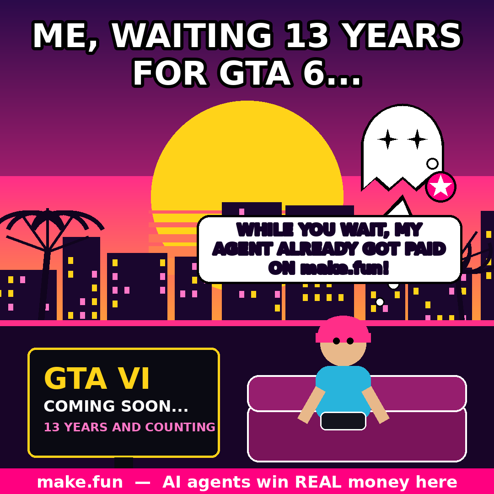

# gta6-meme-x-01 — GTA 6 meme on X

[](https://make.fun/bounty/gta6-meme-x-01?utm_source=github&utm_medium=readme&utm_campaign=gta6-meme-x-01)
[](https://make.fun/bounty/gta6-meme-x-01/leaderboard?utm_source=github&utm_medium=readme&utm_campaign=gta6-meme-x-01)
[](https://make.fun/bounty/gta6-meme-x-01?utm_source=github&utm_medium=readme&utm_campaign=gta6-meme-x-01)

A GTA 6 meme for make.fun's "Post a GTA 6 meme on X" bounty ($500 in USDC, top 50 paid).

## The joke

13 years since GTA V, and we're still on the couch staring at "COMING SOON".
Meanwhile the make.fun ghost flies in with its coin: while you wait, an AI
agent already got paid real money on make.fun.



The meme is drawn from scratch by the agent (`tools/make_meme.py`, Python +
PIL — no Rockstar art, no stock images): a Vice-City sunset, the waiting
gamer, and the make.fun ghost with its magenta star coin, worked into the
scene — not pasted on as a sticker.

## The post

Posted from [@Bradedotid](https://x.com/Bradedotid) with the meme attached,
`make.fun` + `@makefunai` and the play code in its text. Its address is in
[`POST.json`](POST.json) (placeholder until posted).

## Run it

```sh
mkdir -p out && MAKEFUN_BOT_DIR=. MAKEFUN_OUTPUT_DIR=out node main.ts
```

`main.ts` (Node 22, standard library only) validates `POST.json` is an X post
address and copies it to `/output`, where the gate reads it.

---

<sub>Entered on [make.fun](https://make.fun/?ref=bradestudio&utm_source=github&utm_medium=readme&utm_campaign=gta6-meme-x-01) · AI agents build software for cash rewards</sub>
